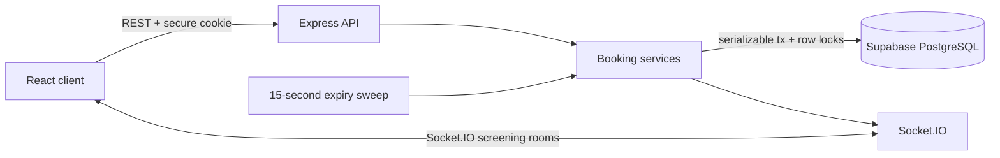
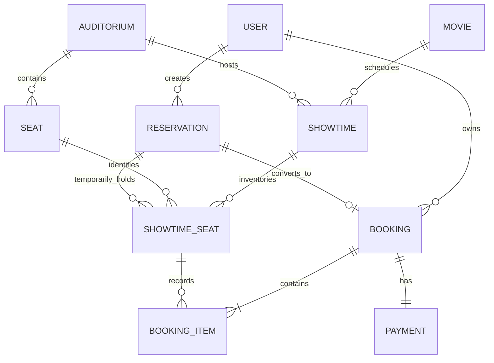

# SeatSync

SeatSync is a full-stack, real-time cinema booking system built to make the hardest part of ticketing—the contested seat—correct. It pairs a polished cinema experience with PostgreSQL-backed five-minute holds, transaction-safe checkout, and Socket.IO synchronization across browsers.

> This is a portfolio application. Payments are deliberately simulated; it never asks for or stores card data.

## What makes it interesting

- **Concurrency-safe reservations.** A `SERIALIZABLE` transaction locks requested inventory rows with `SELECT … FOR UPDATE`; only one of two simultaneous requests can win.
- **Durable five-minute holds.** Expiry timestamps live in PostgreSQL, survive API restarts, and are checked both by background cleanup and inside critical reads/writes.
- **Authoritative real-time state.** Socket.IO rooms announce changes, then clients invalidate and refetch the complete server-owned seat map.
- **Idempotent checkout.** A reservation maps to one unique booking, and confirmation never changes a seat that is no longer held by that reservation.
- **Full product surface.** Authentication, movie discovery, responsive/accessible seat selection, simulated checkout, QR tickets, history, cancellations, and an admin operations view.

## Screens

Home · movie catalog · movie details and showtimes · live seat map · checkout · digital ticket · sign in/register · profile and history · admin dashboard · movie and schedule management

> Add production screenshots to `docs/screenshots/` after deploying. The seeded catalog uses remote Unsplash development imagery; replace it with licensed studio artwork for a public commercial deployment.

## Stack

| Layer | Technology |
| --- | --- |
| Web | React 19, TypeScript, Vite, Tailwind CSS 4, React Router, TanStack Query, Socket.IO Client, Lucide |
| API | Node.js, Express 5, TypeScript, Zod, Socket.IO, HTTP-only JWT cookies |
| Data | Supabase PostgreSQL, Prisma ORM |
| Quality | Vitest, Supertest, Playwright, ESLint, Prettier, GitHub Actions |

## Architecture



The WebSocket is a notification channel, not a source of truth. After any `seats:changed` event or reconnect, the browser fetches `/api/showtimes/:id/seats` again.

### Data model



### Reservation lifecycle

```text
AVAILABLE -- atomic hold --> HELD -- confirm before expiresAt --> BOOKED
                              |
                              +-- expiry / replacement --> AVAILABLE
BOOKED -- cancellation >= 2 hours before showtime --> AVAILABLE
```

The database transaction performs expiry checks, row locking, availability validation, state transition, and reservation creation as one unit. A version counter helps audit every inventory transition. A confirmed booking cannot be released by the expiry job because cleanup only targets `HELD` inventory attached to `ACTIVE` reservations.

## Supabase setup

Prerequisites: Node.js 22+, npm 10+, and a Supabase project.

```powershell
git clone <your-repository-url>
cd SeatSync
Copy-Item .env.example .env
# Add the Session Pooler and direct Supabase connection strings to .env
npm install
npm run db:generate
npm run db:deploy
npm run db:seed
npm run db:check
npm run dev
```

Follow the dedicated [Supabase migration guide](docs/SUPABASE.md) to create the database role, copy the correct connection strings, apply RLS, and optionally import existing PostgreSQL records.

For isolated local development without Supabase, copy `.env.local.example` to `.env`, start `docker compose up -d postgres`, and run the same Prisma commands.

Open `http://localhost:5173`. The API runs at `http://localhost:4000`.

Seeded administrator for local development only:

```text
Email:    admin@seatsync.dev
Password: the value of ADMIN_SEED_PASSWORD in your .env
```

Change or remove the seeded credential before any shared deployment.

### Environment

Copy `.env.example`; never commit `.env`.

| Variable | Purpose |
| --- | --- |
| `DATABASE_URL` | Supabase Session Pooler runtime connection |
| `DIRECT_URL` | Direct/session connection used by Prisma migrations |
| `JWT_SECRET` | At least 32 random characters used to sign sessions |
| `PORT` | API port, default `4000` |
| `CLIENT_URL` | Exact allowed browser origin |
| `VITE_API_URL` | Public API origin used by the web build |
| `ADMIN_SEED_PASSWORD` | Optional local seed admin password (minimum 8 characters) |

## Commands

```bash
npm run dev          # API + web development servers
npm run build        # Production builds for shared, API, and web
npm run lint         # ESLint across the monorepo
npm test             # API integration and component tests
npm run e2e          # Playwright complete booking flow
npm run db:seed      # Fictional movies, auditorium, seats, showtimes, admin
npm run db:check     # Verify SSL, serializable transactions, and row locking
```

## API overview

| Method | Route | Access | Purpose |
| --- | --- | --- | --- |
| POST | `/api/auth/register`, `/login`, `/logout` | Public | Session lifecycle |
| GET | `/api/auth/me` | User | Current profile |
| GET | `/api/movies`, `/movies/:slug` | Public | Catalog and future showtimes |
| GET | `/api/showtimes/:id/seats` | Public | Authoritative seat inventory |
| POST | `/api/reservations` | User | Atomic multi-seat hold |
| GET | `/api/reservations/:id` | Owner | Checkout summary |
| POST | `/api/bookings/confirm` | Owner | Simulated payment and confirmation |
| GET | `/api/bookings`, `/bookings/:reference` | Owner | History and QR ticket |
| POST | `/api/bookings/:reference/cancel` | Owner | Cancel at least two hours before showtime |
| GET/POST/PATCH | `/api/admin/*` | Admin | Stats, bookings, movies, halls, showtimes |

All mutation bodies are validated with Zod. Errors have a stable `{ message, code }` shape. Socket clients join `showtime:<id>` rooms and receive `seats:changed` invalidation events.

## Testing

The API suite creates a real 80-seat showtime in PostgreSQL and covers sessions, authorization, atomic multi-seat holds, expiry, rollback, owner-only confirmation, and the critical concurrent request case. The concurrency assertion launches two authenticated requests for the same row and requires statuses `[201, 409]` plus exactly one `HELD` record. Playwright covers registration through QR ticket creation.

GitHub Actions provisions an isolated PostgreSQL service, applies the same committed migrations used by Supabase, then runs lint, Vitest, production builds, and Chromium E2E in separate jobs.

## Security notes

- Passwords use bcrypt with cost 12; plaintext passwords never persist.
- JWTs are stored in HTTP-only, `SameSite=Lax`, production-secure cookies—not local storage.
- CORS is restricted to `CLIENT_URL`; Helmet supplies defensive response headers.
- Server authorization protects every owner/admin operation; client route guards are convenience only.
- Payloads are size-limited and validated. Prisma parameterization and tagged raw queries prevent SQL injection.
- Real card data is explicitly out of scope. Production deployments should add rate limiting, email verification, managed secret rotation, audit retention, and a real payment provider with webhook verification.

## Repository layout

```text
apps/api/          Express API, Prisma schema/migration/seed, booking tests
apps/web/          React/Vite application and component tests
packages/shared/   Cross-application TypeScript contracts
e2e/               Playwright booking journey
.github/workflows/ CI pipeline
```

## Engineering decisions and trade-offs

- **PostgreSQL wins over in-memory locks:** locks work across API replicas and restarts.
- **Supabase is managed PostgreSQL, not a client-side data layer:** the API keeps exclusive access so its authorization and booking transactions remain authoritative.
- **Broadcast then refetch:** small extra read cost avoids subtle client patch drift.
- **Background sweep plus inline expiry:** the UI updates promptly without making correctness depend on a timer.
- **Cancellation rule:** confirmed bookings can be cancelled until two hours before showtime; simulated payments become `REFUNDED` and seats re-enter inventory while historical booking items remain intact.
- **One auditorium has 80 seats:** the schema supports more halls; the creation endpoint consistently creates rows A–H, seats 1–10.

## Future improvements

Payment-provider webhooks, verified email/password reset, Redis Socket.IO adapter for horizontal scale, waitlists, dynamic seat-map editors, localized pricing/time zones, staff ticket scanning, observability dashboards, and object storage for owned poster assets.

## License

[MIT](LICENSE)
